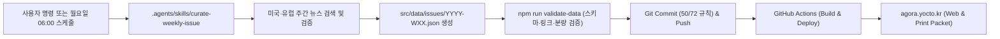

# AGORA (`agora.yocto.kr`) — 주간 글로벌 시사 & MUN 브리핑 설계 문서

> [!IMPORTANT]
> **대상 독자 및 목표**: 13세 국제학교 중학생(G7–G8, CEFR B2–C1 수준)을 위해 매주 월요일 오전 6시(CET/CEST) 기준으로 미국·유럽의 핵심 시사, 과학, 경제 뉴스와 모의유엔(MUN) 토론 가이드, 영영 용어 해설, 영어 원서 추천을 웹과 A4/Letter 인쇄용 패킷으로 제공하는 정적 웹 매거진입니다.

---

## 1. 목적 및 배경 (Intent & Why)

* **핵심 가치**: 어린이용 요약 뉴스보다는 깊이 있고, 성인용 경제지보다는 친절한 **국제학교 중학생 맞춤형 영문 시사·MUN 학습 매거진**을 제공합니다.
* **이중 매체 경험 (Web + Print)**:
  * **모바일·데스크톱 웹**: 어디서나 빠르게 읽고, 본문 속 하이라이트 단어를 탭해 영영 풀이를 확인하거나 단어 플래시카드로 복습할 수 있습니다.
  * **인쇄용 주간 패킷 (`@media print`)**: 웹 메뉴를 자동으로 숨기고, A4/Letter 규격의 깔끔한 다단 편집물과 **‘MUN 입장 정리 및 단어 복습 워크시트(필기란 포함)’**로 출력됩니다.
* **일관성 있는 주간 발행**: 레포지토리 내부에 **전용 워크스페이스 Skill (`.agents/skills/curate-weekly-issue/SKILL.md`)**, **불변 프로젝트 규칙 (`GEMINI.md`)**, 그리고 **자동 데이터 검증 스크립트 (`npm run validate-data`)**를 내장하여 매주 동일한 품질과 포맷으로 콘텐츠가 수집·발행되도록 보장합니다.

---

## 2. 목표, 비목표 및 지양점 (Goals, Non-Goals & Anti-Goals)

### 목표 (Goals)
1. **신뢰할 수 있는 미국·유럽 출처 명시**: 모든 기사와 MUN 브리핑에 Reuters, AP, BBC, The Economist, Financial Times, Politico Europe, NPR, Nature, ESA/NASA, The Guardian, NYT 등 신뢰할 수 있는 원문 출처와 검증된 링크를 명시합니다.
2. **초고속 정적 로딩**: Astro 기반 사전 렌더링(SSG)으로 첫 페이지 진입 시 즉시 렌더링되는 정적 HTML/CSS를 생성합니다.
3. **GitHub Actions 무인 배포**: `https://github.com/chbaede/agora`의 `main` 브랜치에 푸시하면 데이터 스키마 검증 → 타입 체크 → 빌드 → GitHub Pages(`agora.yocto.kr`) 배포가 자동으로 이루어집니다.
4. **첫 호(Issue #1 / `2026-W45`) 즉시 수록**: 지난 1주일(2026년 11월 2일 ~ 11월 8일) 동안 미국과 유럽에서 실제로 발생한 주요 이슈를 조사하여 첫 번째 호로 수록합니다.

### 비목표 (Non-Goals)
* 별도의 백엔드 서버, 데이터베이스, 로그인/회원가입 기능은 두지 않습니다 (`deploy.sh` 불필요).
* 빌드 또는 런타임에 유료 외부 API 키를 요구하지 않습니다.

### 지양점 (Anti-Goals)
* **검증되지 않은 출처나 깨진 링크**: 원문 URL이 없거나 존재하지 않는 기사는 빌드 단계(`validate-data`)에서 차단합니다.
* **인쇄 시 종이·토너 낭비**: 어두운 배경색, 페이지 중간에 잘리는 단어 카드, 불필요한 장식 요소를 인쇄 시 완벽히 제거합니다.

---

## 3. 제약 사항 및 Git 규칙 (Constraints)

* **레포지토리**: `https://github.com/chbaede/agora` (`main` 브랜치)
* **커스텀 도메인**: `agora.yocto.kr` (`public/CNAME`으로 자동 포함)
* **Git 커밋 규칙 (`GEMINI.md` 및 검증 스크립트로 강제)**:
  * Author & Committer: `Changhyeok Bae <changhyeok.bae@gmail.com>`
  * Commit Title: **50자 이내**
  * Commit Message Body: **한 줄당 72자 이내**

---

## 4. 검토한 접근법 (Approaches)

| 접근법 | 구조 및 특징 | 트레이드오프 | 선택 여부 |
| :--- | :--- | :--- | :--- |
| **A. Astro 정적 사이트(SSG) + JSON 스키마 + 워크스페이스 Skill** | 빌드 시점에 순수 HTML/CSS 생성, 엄격한 TypeScript 스키마 검증, GitHub Actions 자동 배포 | Node.js 빌드 단계 포함 (GitHub Actions에서 자동 실행) | **선택됨 (추천)** |
| **B. Vite + React SPA + 런타임 JSON 페칭** | 브라우저에서 JS 번들 로드 후 JSON 데이터를 가져와 렌더링 | 첫 화면 로딩이 상대적으로 느리고 인쇄 페이지 분할 안정성이 낮음 | 제외 |
| **C. 순수 Vanilla HTML/JS** | 빌드 없이 단일 HTML에서 DOM 조작 | 주차별 아카이브, 누적 단어장, 인쇄 레이아웃 확장이 어려움 | 제외 |

---

## 5. 시스템 아키텍처 및 데이터 설계



### 5.1 디렉토리 구조
```text
agora/
├── GEMINI.md                                  # 프로젝트 불변 규칙 (Git 작성자, 50/72자 커밋 규칙, 품질 기준)
├── .agents/
│   └── skills/
│       └── curate-weekly-issue/
│           └── SKILL.md                       # 주간 시사 수집·MUN 작성·단어 추출·도서 추천 표준 절차서
├── .github/
│   └── workflows/
│       └── deploy.yml                         # GitHub Pages 자동 빌드 및 배포 워크플로우
├── public/
│   ├── CNAME                                  # agora.yocto.kr
│   └── favicon.svg
├── scripts/
│   ├── validate-data.ts                       # 모든 주차 JSON 스키마, 필수 항목, URL 형식 검증
│   └── check-commit-msg.ts                    # 커밋 제목 50자 / 본문 72자 검증 헬퍼
├── src/
│   ├── data/
│   │   ├── schema.ts                          # WeeklyIssue TypeScript 인터페이스 및 검증 로직
│   │   ├── books-ledger.json                  # 추천 도서 누적 기록 (중복 추천 방지용)
│   │   └── issues/
│   │       └── 2026-W45.json                  # 제1호 데이터 (2026.11.02 ~ 11.08 미국·유럽 시사)
│   ├── components/
│   │   ├── Masthead.astro                     # 매거진 헤더, 주차 선택, '인쇄하기(Print Packet)' 버튼
│   │   ├── EditorsNote.astro                  # 이번 주 글로벌 흐름 3줄 요약 및 핵심 키워드
│   │   ├── MunSpotlight.astro                 # 모의유엔 특집 (배경지식, 국가별 입장, 찬반 논점, 1분 스피치 시작 문장)
│   │   ├── ArticleCard.astro                  # 분야별 기사 카드 (하이라이트 단어, Why It Matters, 출처 링크)
│   │   ├── ConceptExplainer.astro             # 이번 주의 경제·외교 핵심 개념 쉽게 풀어보기 박스
│   │   ├── GlossarySection.astro              # 주간 영영 단어·경제 용어 사전 (플래시카드 퀴즈 토글 포함)
│   │   ├── BookCorner.astro                   # 주간 영어 원서 추천 (줄거리, 추천 이유, 독서 토론 질문)
│   │   └── PrintWorksheet.astro               # 인쇄 전용 워크시트 (나의 MUN 입장 정리 노트 & 단어 체크리스트)
│   ├── layouts/
│   │   └── BaseLayout.astro                   # 모바일 반응형 웹 & @media print 통합 레이아웃
│   ├── pages/
│   │   ├── index.astro                        # 최신호 메인 페이지
│   │   ├── archive.astro                      # 지난 호 아카이브 및 추천 도서 모아보기
│   │   ├── glossary.astro                     # 누적 영단어·경제 용어 사전 검색 페이지
│   │   └── issues/
│   │       └── [id].astro                     # 주차별 고유 URL (/issues/2026-W45)
│   └── styles/
│       ├── global.css                         # 에디토리얼 웹 디자인 스타일
│       └── print.css                          # A4/Letter 전용 인쇄 스타일시트
└── package.json
```

### 5.2 매주 수록되는 콘텐츠 구성 (Issue Schema)
매 호(`YYYY-WXX.json`)는 중학생이 일주일 동안 읽고 프린트해 활용하기 가장 좋은 분량(A4 인쇄 기준 약 4~5쪽)으로 구성됩니다.

1. **Editor's Briefing**: 이번 주 미국과 유럽을 관통하는 핵심 흐름 요약
2. **MUN Agenda Spotlight (모의유엔 집중 분석 1건)**:
   * 소속 위원회(예: `UNEP`, `ECOSOC`, `European Parliament`, `WTO`), 의제 배경 설명
   * **Major Bloc Positions**: 미국, 유럽연합(EU), 개발도상국/국제기구 등 주요 주체별 입장 비교
   * **Debate Motion & Pro/Con**: 찬성 측 논거 3가지 vs 반대 측 논거 3가지
   * **Delegate Speech Starter**: 모의유엔 기조연설(Opening Speech)에 바로 활용할 수 있는 영어 표현 템플릿
3. **Curated Weekly Articles (분야별 핵심 기사 5건)**:
   * `US Current Affairs` (미국 시사/정치/사회)
   * `Europe Current Affairs` (유럽 시사/EU 정책)
   * `Economy & Business` (미국·유럽 경제 및 글로벌 시장)
   * `Science & Technology` (우주, AI, 의학, 기초과학)
   * `Environment & Global Society` (기후, 에너지, 문화/교육)
   * 각 기사마다 **본문 내 핵심 어휘 하이라이트**, **Why It Matters (중학생 시선의 핵심 포인트)**, **Discussion Question**, **신뢰 출처 및 원문 링크**, **기사용 영영 어휘 2~3개** 포함
4. **Concept of the Week (이번 주의 경제·시사 개념 1건)**:
   * 예: 관세와 공급망(Tariffs & Supply Chains), 중앙은행 금리(Interest Rates), 탄소국경세(CBAM) 등을 13세 눈높이의 실생활 비유로 영문 해설
5. **Book of the Week (주간 영어 원서 추천 1권)**:
   * 이번 주 시사/과학/경제 주제와 연결되는 중학생 권장 영어 도서 1권 선정, 핵심 메시지 및 독서 토론 질문 수록
6. **Print Study Worksheet (인쇄 시 하단 자동 첨부)**:
   * 출력물 마지막 페이지에 **‘My MUN Position Note’**와 **‘Weekly Vocabulary Check’** 필기 공간 제공
